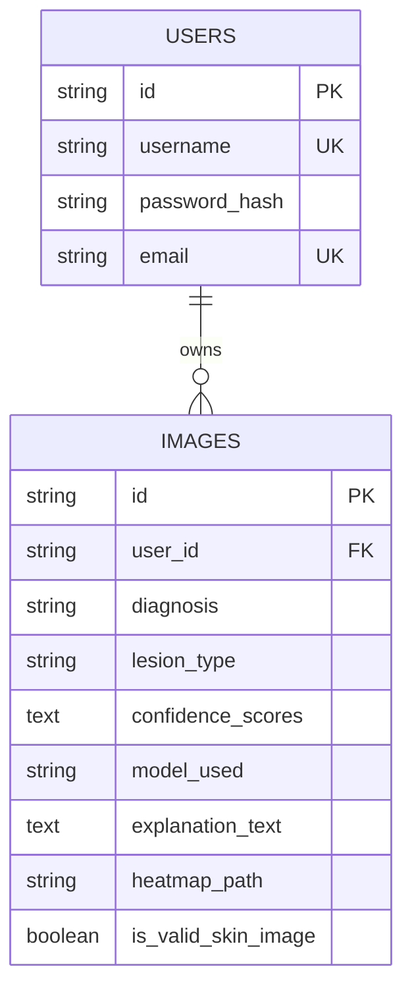

<p align="center">
  
</p>

<p align="center">
  
  
  
  
  
  
</p>

<p align="center">
  <a href="https://cocopops9.github.io/SkinLesionClassification/"><b>Interactive lab</b></a> ·
  <a href="docs/README.md"><b>Docs</b></a> ·
  <a href="#how-it-works">How it works</a> ·
  <a href="#quick-start">Quick start</a> ·
  <a href="#usage-guide">Usage</a> ·
  <a href="#training-your-own-models">Training</a> ·
  <a href="#limitations">Limitations</a>
</p>

A Streamlit application that classifies dermoscopic images of skin lesions into the seven HAM10000 categories with ImageNet-pretrained CNNs (EfficientNetB3, InceptionV3, InceptionResNetV2), optionally combined as an ensemble. Each prediction comes with a Grad-CAM heatmap and a textual report including ABCDE heuristics; a CLIP-based gate rejects images that are not skin photographs, and every analysis is stored in a per-user history.

> [!WARNING]
> **Decision support for dermatologists, not a diagnostic device.** The application must not be used for self-diagnosis. Only a qualified dermatologist is responsible for diagnosis and treatment decisions; AI output is supplementary information.

---

## How it works

One uploaded image travels through seven stages. Every animation in this README is drawn from the exact parameters in the code, and the numeric ones are produced by running the project's own functions ([`docs/assets/generate_figures.py`](docs/assets/generate_figures.py)).

<p align="center"></p>

> [!TIP]
> The **[interactive lab](https://cocopops9.github.io/SkinLesionClassification/)** lets you drive each stage yourself: run the validation gates and the ABCDE port on your own image (locally, nothing is uploaded), build an ensemble, move Grad-CAM channel weights, sample Keras augmentations and replay the training callbacks. Click any stage below to open its window.

<details>
<summary><b>① Upload</b> · the file is stored under your account</summary>
<br>

`st.file_uploader` accepts JPG, JPEG, PNG and BMP. The file is written to `user_uploads/<user_id>/<uuid>_<filename>`, so each user's images are kept apart. Validation starts immediately; classification starts when you press **Analyze Image**.

Code: [`app.py` → `analysis_page`](app.py)
</details>

<details>
<summary><b>② Validate</b> · is this really a skin photograph?</summary>
<br>


Three gates, first failure wins: **dimensions** (100 to 10,000 px per side, aspect ratio ≤ 5), **simple graphic** (fewer than 30 unique colours after resizing to 100 × 100), and **CLIP ViT-B/32 zero-shot**, which compares the image with *"a dermoscopic or clinical photograph of a skin lesion or mole"* and *"a photograph that is not a medical skin image"*. A rejected image can still be analysed after the user explicitly confirms it.

Code: [`image_validator.py`](image_validator.py) · Deep dive: [docs/03](docs/03-input-validation.md)
</details>

<details>
<summary><b>③ Preprocess</b> · pixels become a tensor</summary>
<br>

The image is resized to 224 × 224 (EfficientNetB3) or 299 × 299 (Inception models), passed through the backbone's `preprocess_input` and divided by 255, exactly as in training.

Code: [`classification.py` → `preprocess_image`](classification.py) · Deep dive: [docs/04](docs/04-preprocessing-and-architecture.md)
</details>

<details>
<summary><b>④ Classify</b> · a pretrained backbone and a small head</summary>
<br>


Each model is an ImageNet backbone without its top, followed by `GlobalAveragePooling2D → Dense 256 ReLU → Dropout 0.2 → Dense 128 ReLU → Dropout 0.1 → Dense 7 softmax`. Weights are downloaded from Google Drive into `models/` on first use.

| Model | Input | Parameters | Declared accuracy |
|---|---:|---:|---:|
| EfficientNetB3 | 224 | 11.2 M | 0.85 |
| InceptionV3 | 299 | 22.4 M | 0.84 |
| InceptionResNetV2 | 299 | 54.8 M | 0.79 |

The accuracies are constants in `MODEL_CONFIGS`; the repository does not include the evaluation that produced them.

Code: [`classification.py`](classification.py) · Deep dive: [docs/04](docs/04-preprocessing-and-architecture.md)
</details>

<details>
<summary><b>⑤ Fuse</b> · one model, or an accuracy-weighted ensemble</summary>
<br>



With two or three models selected, the probability vectors are averaged with weights proportional to the declared accuracies, $\mathbf{p} = \sum_m a_m \mathbf{p}_m / \sum_m a_m$, and the diagnosis is the argmax. A red alert is shown for AKIEC, BCC and MEL.

Code: [`classification.py` → `predict_ensemble`](classification.py) · Deep dive: [docs/06](docs/06-inference-and-ensemble.md)
</details>

<details>
<summary><b>⑥ Explain</b> · Grad-CAM heatmap and a written report with ABCDE heuristics</summary>
<br>


**Grad-CAM** weights the last convolutional feature maps of the first selected model by their average gradient for the predicted class, keeps the positive part, normalises it and overlays it with the JET colormap at 40 % opacity.


The **report** lists dermoscopic features to check for the predicted class, the differential diagnosis and the ABCDE scores (Asymmetry, Border, Colour, Diameter; Evolution needs follow-up images). These are image-level heuristics: as the figure shows, Otsu thresholding keeps the *brighter* region, which is usually the skin around the lesion. Read [docs/09](docs/09-abcde-heuristics.md) before relying on them.

Code: [`explainability.py`](explainability.py) · Deep dives: [docs/07](docs/07-grad-cam.md), [docs/08](docs/08-occlusion-sensitivity.md), [docs/09](docs/09-abcde-heuristics.md)
</details>

<details>
<summary><b>⑦ Store</b> · accounts, history and files</summary>
<br>

Passwords are hashed with bcrypt (cost 12). Each analysis becomes a row of the `images` table in a local SQLite database (via SQLAlchemy), linked to its user; the Grad-CAM map is saved as `heatmaps/<uuid>_heatmap.npy`. The History page shows statistics, the 50 most recent analyses, and lets you rename or delete them; Settings exports the history as CSV.



Code: [`database.py`](database.py) · Deep dive: [docs/10](docs/10-application-storage-security.md)
</details>

### Learn the algorithms step by step

The [`docs/`](docs/README.md) folder is a guided course that follows the same path, one chapter per stage:

| | | | |
|---|---|---|---|
| [01 System overview](docs/01-system-overview.md) | [02 Labels and data](docs/02-dataset-and-labels.md) | [03 Input validation](docs/03-input-validation.md) | [04 Preprocessing and architecture](docs/04-preprocessing-and-architecture.md) |
| [05 Training](docs/05-training.md) | [06 Inference and ensemble](docs/06-inference-and-ensemble.md) | [07 Grad-CAM](docs/07-grad-cam.md) | [08 Occlusion sensitivity](docs/08-occlusion-sensitivity.md) |
| [09 ABCDE heuristics](docs/09-abcde-heuristics.md) | [10 Application, storage, security](docs/10-application-storage-security.md) | [11 Limitations and verification](docs/11-limitations-and-verification.md) | [Interactive lab](https://cocopops9.github.io/SkinLesionClassification/) |

---

## Quick start

```bash
git clone https://github.com/cocopops9/SkinLesionClassification.git
cd SkinLesionClassification
python -m venv venv
source venv/bin/activate          # Windows: venv\Scripts\activate
pip install -r requirements.txt   # includes CLIP from GitHub and PyTorch
streamlit run app.py              # opens http://localhost:8501
```

Alternatively `python run.py` creates `venv/` if missing, installs the requirements, optionally runs `test_system.py` and starts the app.

**Requirements:** Python 3.11 or 3.12 recommended (3.13 is supported by TensorFlow 2.20 but less tested), about 8 GB of RAM, internet access on first use to download the CNN weights (Google Drive, several hundred MB for all three) and the CLIP ViT-B/32 weights (about 340 MB). `classification.py` sets `CUDA_VISIBLE_DEVICES=-1`, so TensorFlow inference runs on the CPU.

## Usage guide

### 1 · Create an account and log in

On the **Register** tab choose a username (at least 3 characters), an email and a password (at least 8 characters), and acknowledge that the tool is decision support. Then log in on the **Login** tab. The session lasts until you press **Logout** or close the browser session.

### 2 · Configure the analysis in the sidebar

| Setting | Options | Default |
|---|---|---|
| Model Selection Mode | Single Model · Ensemble (Multiple) | Single Model |
| Choose Model / Select Models for Ensemble | EfficientNetB3, InceptionV3, InceptionResNetV2 | EfficientNetB3 / EfficientNetB3 + InceptionV3 |
| Generate Explainability Report | Grad-CAM computation and text report | on |
| Show Grad-CAM Heatmap | save and display the overlay (needs the report) | on |
| Save to History | store the analysis in the database | on |

### 3 · Analyse an image

1. On **New Analysis**, upload a dermoscopic or clinical image (JPG, JPEG, PNG, BMP). Sample images are in [`media/`](media/).
2. Read the validation result. If the image is rejected but you are sure it is a skin lesion, tick the confirmation checkbox.
3. Press **Analyze Image**. The first run downloads and builds the model and takes noticeably longer.
4. Review the diagnosis, lesion type, confidence, the per-class bar chart, the explanation and the Grad-CAM overlay.

### 4 · Manage your history

**History** shows totals, valid images and "Malignant findings", a table of recent analyses and a detail view where you can rename or delete an entry. **Settings** exports your history as CSV.

### Check your installation

```bash
python test_system.py   # imports, database, TensorFlow, validator, directories
```

### Use the modules from Python

```python
from classification import MelanomaClassifier
from explainability import ExplainabilityEngine
from image_validator import ImageValidator
from PIL import Image
import numpy as np

validator = ImageValidator()
report = validator.validate_image(Image.open("media/melanoma.jpg"))      # {'is_valid', 'confidence', 'reasons', 'warnings'}

classifier = MelanomaClassifier()                                        # weights go to models/
result = classifier.get_prediction_with_metadata("media/melanoma.jpg",
                                                 ["EfficientNetB3", "InceptionV3"])
print(result["diagnosis"], result["confidence"])

model, size = classifier.get_model_for_explainability("EfficientNetB3")
x = classifier.preprocess_image("media/melanoma.jpg", "EfficientNetB3")
heatmap = ExplainabilityEngine.compute_gradcam(model, x, result["predicted_class"])
image = np.array(Image.open("media/melanoma.jpg").convert("RGB"))
overlay = ExplainabilityEngine.overlay_heatmap(image, heatmap)
```

## Training your own models

```bash
python train.py --model EfficientNetB3                                 # 15 epochs head + 30 epochs fine-tuning
python train.py --model InceptionV3 --epochs1 20 --epochs2 40 --batch-size 16
tensorboard --logdir training_logs/tensorboard
```

<p align="center"></p>

Phase 1 trains only the new head on a frozen ImageNet backbone (Adam 1e-4); phase 2 fine-tunes all layers (Adam 1e-5). Balanced class weights, random augmentation, `EarlyStopping`, `ReduceLROnPlateau`, `ModelCheckpoint`, CSV and TensorBoard logging are configured in [`train_config.py`](train_config.py).

| Flag | Meaning | Default |
|---|---|---|
| `--model` | `EfficientNetB3`, `InceptionV3` or `InceptionResNetV2` | required |
| `--epochs1` / `--epochs2` | maximum epochs of phase 1 / phase 2 | 15 / 30 |
| `--batch-size` | batch size | 32 |
| `--skip-phase2` | train the head only | off |

> [!CAUTION]
> Provide an explicit `data/val/` folder: without it, the automatic 20 % split currently yields an empty validation set (see [docs/05](docs/05-training.md)). `--unfreeze-layers` is accepted but has no effect, and `--skip-phase1` stops with an error because phase 2 needs the phase-1 model.

Expected layout: `data/train/<CLASS>/*.jpg` with the folders `AKIEC BCC BKL DF MEL NV VASC` (plus optional `data/val/` and `data/test/`). Copy a finished model from `trained_models/` to `models/<name>.h5` (the file name in `MODEL_CONFIGS`) to serve it. Full guide: [TRAINING_README.md](TRAINING_README.md). To point the app at different Google Drive files, run `python update_drive_links.py` ([SETUP_DRIVE_LINKS.md](SETUP_DRIVE_LINKS.md)).

## Project structure

```text
SkinLesionClassification/
├── app.py                  Streamlit UI and analysis orchestration
├── classification.py       MelanomaClassifier: weights, models, preprocessing, ensemble
├── explainability.py       ExplainabilityEngine: Grad-CAM, occlusion, ABCDE, report text
├── image_validator.py      ImageValidator: dimension, colour and CLIP gates
├── database.py             SQLAlchemy models, bcrypt, DatabaseManager
├── train.py                two-phase transfer-learning script
├── train_config.py         training hyperparameters and paths
├── update_drive_links.py   helper to change the Google Drive weight URLs
├── run.py                  launcher: venv, requirements, tests, app
├── test_system.py          installation self-test
├── requirements.txt
├── media/                  sample lesion images
├── docs/                   guided documentation, animated figures, interactive lab
│   ├── index.html          interactive lab (GitHub Pages)
│   ├── 01 … 11 *.md        chapters
│   ├── assets/             SVG animations + generate_figures.py
│   └── lab/                lab code, JavaScript port of the heuristics, verification scripts
├── TRAINING_README.md · SETUP_DRIVE_LINKS.md · ABCDE_ANALYSIS.md
└── created at runtime: models/ · user_uploads/ · heatmaps/ · melanoma_app.db
                        trained_models/ · checkpoints/ · training_logs/ (training)
```

## Limitations

* **Clinical:** no regulatory approval, no prospective validation, seven classes only, trained for dermoscopy (HAM10000, mostly lighter skin types); softmax confidences are not calibrated probabilities.
* **Explanations:** Grad-CAM is coarse (7 × 7 or 8 × 8) and uses the first selected model only; the ABCDE numbers are image-level heuristics with a fixed 10 px/mm scale.
* **Engineering:** local SQLite and file storage, no email verification or password reset, uploads are rewritten on every Streamlit rerun.

All verified findings, with the evidence behind each, are collected in [docs/11](docs/11-limitations-and-verification.md).

## Troubleshooting

| Symptom | Fix |
|---|---|
| Weight download fails | Check the connection and that the Drive files are shared publicly; update the IDs with `update_drive_links.py`, or place the `.h5` files in `models/` manually. |
| "CLIP not available" warning | `pip install git+https://github.com/openai/CLIP.git torch torchvision`; without CLIP, gate 3 is skipped. |
| Database errors | Stop the app, delete `melanoma_app.db` (this erases accounts and history) and restart. |
| Out of memory | Use a single model instead of an ensemble; InceptionResNetV2 is the largest. |
| Image rejected | Use a focused photograph of the lesion; the confirmation checkbox allows analysis anyway. |

## Citation

```bibtex
@article{tschandl2018ham10000,
  title   = {The HAM10000 dataset, a large collection of multi-source dermatoscopic images of common pigmented skin lesions},
  author  = {Tschandl, Philipp and Rosendahl, Cliff and Kittler, Harald},
  journal = {Scientific Data},
  volume  = {5},
  pages   = {180161},
  year    = {2018}
}
```

Further references (EfficientNet, Inception, CLIP, Grad-CAM, Otsu, bcrypt) are listed in [docs/11](docs/11-limitations-and-verification.md#references).

## License and disclaimer

This project is for educational and research purposes; model weights are subject to their original licenses. It is a decision support system for dermatologists: only qualified dermatologists are responsible for the final diagnosis and treatment, and the authors assume no liability for decisions made with this software.
