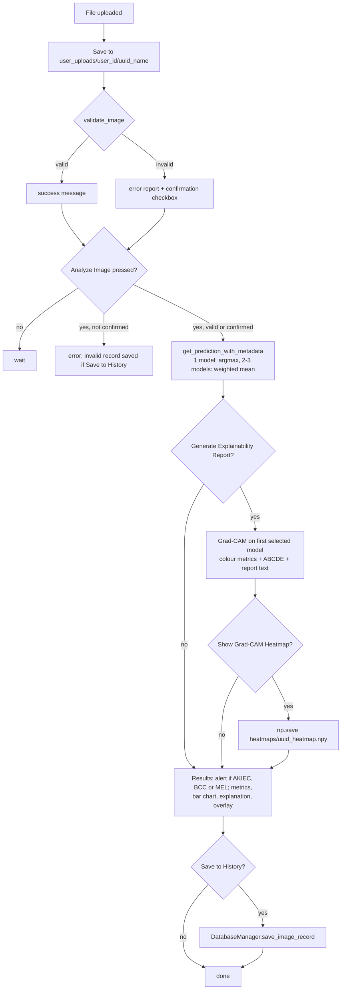

# 01 · System overview

[Docs index](README.md) · Next: [02 Labels and data →](02-dataset-and-labels.md)

The project is a single-process Streamlit application. All computation happens locally: the CNN weights are downloaded once from Google Drive, CLIP weights are downloaded once by the `clip` package, and all user data stays in a SQLite file and two folders next to the code.

## Components

| Module | Class / functions | Responsibility | Key technology |
|---|---|---|---|
| `app.py` | `login_page`, `main_application`, `analysis_page`, `history_page`, `settings_page`, `about_page` | UI, page routing through `st.session_state`, orchestration of the analysis | Streamlit |
| `image_validator.py` | `ImageValidator` | Reject inputs that are not skin photographs | OpenCV, OpenAI CLIP (PyTorch) |
| `classification.py` | `MelanomaClassifier` | Download weights, build models, preprocess, predict, ensemble | TensorFlow / Keras, gdown |
| `explainability.py` | `ExplainabilityEngine` | Grad-CAM, occlusion sensitivity, ABCDE heuristics, report text | TensorFlow `GradientTape`, OpenCV |
| `database.py` | `User`, `ImageRecord`, `DatabaseManager` | Accounts and analysis history | SQLAlchemy ORM, SQLite, bcrypt |
| `train.py`, `train_config.py` | `ModelTrainer`, `TrainConfig` | Two-phase transfer learning on HAM10000 | Keras `ImageDataGenerator`, callbacks |

Models and the validator are created once per server process through `@st.cache_resource`, and Keras models are cached inside `MelanomaClassifier.loaded_models`, so the first analysis is slow (download and graph construction) and later ones are fast.

## Control flow of one analysis

The diagram below is the actual branching inside `analysis_page()`.

Three sidebar options drive the branches: **Generate Explainability Report**, **Show Grad-CAM Heatmap** and **Save to History** (all on by default). The sidebar also selects **Single Model** (a dropdown) or **Ensemble (Multiple)** (a multiselect, default EfficientNetB3 + InceptionV3).

## Why this structure

* **Validation before classification.** A softmax classifier always outputs a distribution over its 7 classes, even for a photo of a cat. A separate gate is the simplest guard against out-of-distribution input ([chapter 03](03-input-validation.md)).
* **Several backbones.** Different architectures make partly independent errors, which is the premise of ensembling ([chapter 06](06-inference-and-ensemble.md)).
* **Explanations next to predictions.** The tool is designed as decision support for dermatologists: a heatmap and a textual checklist let the clinician judge whether the model attended to plausible evidence ([chapters 07](07-grad-cam.md) and [09](09-abcde-heuristics.md)).

## Timing semantics

* Validation runs immediately on upload, and again on every Streamlit rerun of the page.
* The "Total processing time" caption is `prediction_data['processing_time']`, measured inside `get_prediction_with_metadata`: it covers classification only, not validation or explanation.

[Docs index](README.md) · Next: [02 Labels and data →](02-dataset-and-labels.md)
