# 03 · Input validation

[← 02 Labels and data](02-dataset-and-labels.md) · [Docs index](README.md) · Next: [04 Preprocessing and architecture →](04-preprocessing-and-architecture.md)

A 7-way softmax classifier cannot say "none of the above": any input, even a screenshot, is mapped to a probability distribution over the seven lesion classes. `ImageValidator.validate_image` is therefore placed in front of the classifier. It runs three checks in order and returns at the first failure.

## Gate 1 · dimensions (`validate_image_dimensions`)

| Condition | Message |
|---|---|
| height < 100 or width < 100 | `Image too small (minimum 100x100 pixels required)` |
| height > 10000 or width > 10000 | `Image too large (maximum 10000x10000 pixels)` |
| max(W, H) / min(W, H) > 5 | `Unusual aspect ratio (r:1), likely not a medical image` |

## Gate 2 · simple-graphic detection

If the image height exceeds 100 px it is resized to 100 × 100 with `cv2.resize` (bilinear); the number of distinct RGB triples is then counted. Fewer than **30** unique colours means "simple graphic" (icons, flat drawings). Natural photographs contain thousands of distinct colours even at 100 × 100 because of sensor noise, shading and texture; the synthetic lesion used in the lab yields about 4,900.

The condition tests the height only: an image 100 px high and 500 px wide is counted at full resolution.

## Gate 3 · CLIP zero-shot classification (`validate_with_clip`)

CLIP (Radford et al., 2021) trains an image encoder $f$ and a text encoder $g$ so that matching image-caption pairs have a high cosine similarity. This lets an image be classified against arbitrary text prompts without task-specific training ("zero-shot"). The validator uses ViT-B/32 and two prompts:

* `"a dermoscopic or clinical photograph of a skin lesion or mole"`
* `"a photograph that is not a medical skin image"`

With L2-normalised embeddings the similarities are cosines $s_\text{skin}, s_\text{non} \in [-1, 1]$, and the code computes

$$
p_\text{skin} = \operatorname{softmax}(s_\text{skin}, s_\text{non})_1 = \sigma(s_\text{skin} - s_\text{non}),
$$

accepting the image when $p_\text{skin} \ge 0.5$.

> [!NOTE]
> **Calibration.** CLIP's reference zero-shot procedure multiplies cosines by a learned logit scale, $e^{t} = 100$, before the softmax. The code omits it. Typical CLIP cosine gaps are a few hundredths, so the implemented $p_\text{skin}$ stays roughly between 0.47 and 0.53: the stored "confidence" carries little information. The **decision is unaffected**, because $\sigma(x) \ge 0.5 \iff x \ge 0$ for any positive scale. The interactive lab shows both versions side by side.

If CLIP cannot be imported or loaded, gate 3 is skipped: the image is accepted with the warning `CLIP not available - validation skipped`. If CLIP raises during inference, the image is also accepted.

## What happens after a rejection

The app shows the validation report as an error and offers the checkbox *"I confirm this is a valid skin lesion image - proceed with analysis"*. Ticking it lets the analysis run; pressing **Analyze Image** without ticking it stores an invalid-image record (when "Save to History" is on) and stops.

## Code that exists but is not called

`image_validator.py` also defines statistical helpers (`detect_skin_presence`, `analyze_color_statistics`, `detect_uniform_regions`, `analyze_texture_uniformity`, `detect_text_presence`). `validate_image` does not call any of them, and `detect_skin_presence` references attributes (`skin_hsv_lower`, ...) that `__init__` never defines, so it would raise if called. Earlier documentation that mentions a MobileNetV2 validator describes an older version; the current gate is CLIP only.

## Limits of this design

* Zero-shot CLIP with two prompts is a coarse out-of-distribution detector. Close-up photographs of normal skin, wounds or rashes can pass; unusual dermoscopy (polarised, very dark skin types, ruler overlays) can occasionally fail.
* Rejection is advisory: the user can override it.

Try gates 1 and 2 on your own images, and explore the CLIP probability, in the [interactive lab](https://cocopops9.github.io/SkinLesionClassification/#validation).

[← 02 Labels and data](02-dataset-and-labels.md) · [Docs index](README.md) · Next: [04 Preprocessing and architecture →](04-preprocessing-and-architecture.md)
