# 04 · Preprocessing and network architecture

[← 03 Input validation](03-input-validation.md) · [Docs index](README.md) · Next: [05 Training →](05-training.md)

## Preprocessing (`MelanomaClassifier.preprocess_image`)

```python
img = image.load_img(img_path, target_size=(img_size, img_size))   # PIL, RGB, resized (aspect ratio not kept)
img_array = np.expand_dims(image.img_to_array(img), axis=0)        # float32, shape (1, S, S, 3), values 0..255
img_array = preprocess_input(img_array)                            # backbone-specific
img_array = img_array / 255.0
```

`train.py` uses the identical transform (`preprocessing_function=lambda x: preprocess_input(x) / 255.0`), so training and inference agree. The resulting value ranges are unusual, though:

| Backbone | `S` | `preprocess_input` | after `/ 255` | inside the model |
|---|---:|---|---|---|
| EfficientNetB3 | 224 | identity | [0, 1] | `Rescaling(1/255)` → [0, 0.0039], then `Normalization` with ImageNet statistics |
| InceptionV3 | 299 | `x / 127.5 − 1` → [−1, 1] | [−0.0039, 0.0039] | nothing |
| InceptionResNetV2 | 299 | `x / 127.5 − 1` → [−1, 1] | [−0.0039, 0.0039] | nothing |

In other words the image is scaled by 1/255 once more than the backbones expect. Because training used the same transform, the fine-tuned weights are adapted to it; the cost is that the ImageNet initialisation started from inputs about 255 times smaller than those it was pretrained on.

> [!WARNING]
> **EfficientNetB3 train/inference graph difference.** In current Keras (verified in the Keras 3.15 source), `EfficientNetB3(weights='imagenet')` inserts an extra `Rescaling(1/√σ)` layer after `Normalization`, while `EfficientNetB3(weights=None)` does not. `train.py` builds with `'imagenet'`, `classification.py` builds with `None` and then loads the weights. Both graphs have the same weight tensors, so loading succeeds, but at inference the normalised input is about 0.48 times what it was in training. This matters only if the downloaded weights were trained with this repository's `train.py` under such a Keras version; their provenance is not recorded.

## The model

<p align="center"></p>

Every model is `Backbone(include_top=False)` followed by the same head:

```text
GlobalAveragePooling2D → Dense(256, ReLU) → Dropout(0.2) → Dense(128, ReLU) → Dropout(0.1) → Dense(7, softmax)
```

* **Global average pooling** reduces each of the $C$ final feature maps to its mean, giving a $C$-dimensional, translation-invariant descriptor and far fewer parameters than flattening.
* **Dense + ReLU** layers learn a non-linear combination of these features specific to skin lesions.
* **Dropout** zeroes a random fraction of units during training only (and rescales the rest by $1/(1-p)$), which discourages co-adapted features; at inference it is the identity.
* **Softmax** turns the 7 logits into a probability vector: $p_i = e^{z_i} / \sum_j e^{z_j}$.

Measured with TensorFlow 2.20:

| Backbone | Input | Final feature map | Total parameters | Head parameters |
|---|---:|---|---:|---:|
| EfficientNetB3 | 224 | 7 × 7 × 1536 | 11,210,806 | 427,271 |
| InceptionV3 | 299 | 8 × 8 × 2048 | 22,361,127 | 558,343 |
| InceptionResNetV2 | 299 | 8 × 8 × 1536 | 54,764,007 | 427,271 |

Head parameters for $C$ channels: $(C \cdot 256 + 256) + (256 \cdot 128 + 128) + (128 \cdot 7 + 7)$.

## The three backbones

**EfficientNetB3** (Tan and Le, 2019). EfficientNets scale network depth $d$, width $w$ and input resolution $r$ together with one coefficient $\phi$: $d = \alpha^\phi$, $w = \beta^\phi$, $r = \gamma^\phi$, with $\alpha \beta^2 \gamma^2 \approx 2$, so that each step roughly doubles the FLOPs. The building block is the inverted-residual MBConv with depthwise convolutions and squeeze-and-excitation channel attention. B3 is a mid-size member; Keras' reference resolution for B3 is 300 px, while this project uses 224 px.

**InceptionV3** (Szegedy et al., 2016). Inception modules run several convolution branches in parallel (1×1, factorised 3×3 and 7×7 as 1×n followed by n×1, pooling) and concatenate their outputs, so the layer chooses its receptive field per feature. The last block, `mixed10`, concatenates four branches into 2048 channels.

**InceptionResNetV2** (Szegedy et al., 2017). Inception modules whose outputs are added to their input through residual connections, which eases optimisation of very deep networks. It is the largest of the three.

## Weight loading

`get_model` downloads `<name>.h5` from Google Drive with `gdown` into `models/` (first use only), rebuilds the architecture with `weights=None` and calls `model.load_weights`. The URLs live in `MODEL_CONFIGS` and can be changed with `update_drive_links.py` (see `SETUP_DRIVE_LINKS.md`).

Explore the layers and the preprocessing ranges in the [interactive lab](https://cocopops9.github.io/SkinLesionClassification/#preprocessing).

[← 03 Input validation](03-input-validation.md) · [Docs index](README.md) · Next: [05 Training →](05-training.md)
