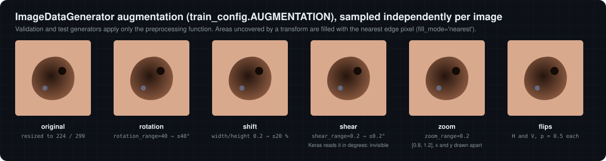

# 05 · Training: two-phase transfer learning

[← 04 Preprocessing and architecture](04-preprocessing-and-architecture.md) · [Docs index](README.md) · Next: [06 Inference and ensemble →](06-inference-and-ensemble.md)

HAM10000 has about ten thousand images, too few to train a 10 to 55 million parameter network from scratch without overfitting. **Transfer learning** starts from weights learned on ImageNet (1.28 M natural images), whose early filters (edges, colour blobs, textures) are useful for dermoscopy too, and adapts them. `train.py` does this in two phases.

<p align="center"></p>

## Phase 1 · train the head (`train_phase1`)

* Backbone created with `weights='imagenet'` and `base_model.trainable = False`.
* Only the new head (≈ 0.43 to 0.56 M parameters) is updated.
* Adam, learning rate `1e-4`, categorical cross-entropy, balanced class weights, up to `EPOCHS_PHASE1 = 15` epochs.

The randomly initialised head would otherwise send large, noisy gradients into the pretrained backbone and destroy its features in the first steps. Training it first gives it a sensible starting point.

## Phase 2 · fine-tune everything (`train_phase2`)

* All layers set trainable, model recompiled with Adam at `1e-5` (10× smaller), up to `EPOCHS_PHASE2 = 30` epochs.
* Fresh callback instances, so patience counters restart.

The small learning rate lets the backbone adapt to dermoscopic texture and colour without large jumps away from the pretrained solution.

> [!WARNING]
> **`--unfreeze-layers` has no effect.** The code looks for the backbone at `self.model.layers[0]`, but in the functional model that layer is the `InputLayer`, which has no `layers` attribute, so the `else` branch unfreezes the whole model regardless of the argument (verified with TensorFlow 2.20).

## Loss and metrics

Categorical cross-entropy for one-hot target $y$ and prediction $p$, weighted by the class weight of the true class ([chapter 02](02-dataset-and-labels.md)):

$$
\mathcal{L} = - w_{c(y)} \sum_{i=1}^{7} y_i \log p_i .
$$

Reported metrics: accuracy and `AUC` (Keras' default ROC AUC computed over the flattened one-hot labels, i.e. a micro-average across classes).

## Data augmentation

<p align="center"></p>

`ImageDataGenerator` draws new random parameters for every training image and every epoch:

| Parameter | Value | Sampled as |
|---|---|---|
| `rotation_range` | 40 | θ ~ U(−40°, 40°) |
| `width_shift_range`, `height_shift_range` | 0.2 | shift ~ U(−0.2, 0.2) × image side |
| `shear_range` | 0.2 | shear ~ U(−0.2°, 0.2°): Keras interprets it in **degrees**, so this is practically no shear |
| `zoom_range` | 0.2 | zx, zy ~ U(0.8, 1.2) independently, which also changes the aspect ratio |
| `horizontal_flip`, `vertical_flip` | True | each with probability 0.5 |
| `fill_mode` | `'nearest'` | uncovered pixels copy the nearest edge pixel |

The affine part is composed as rotation · shift · shear · zoom about the image centre and applied with bilinear interpolation; flips follow, then the preprocessing function. Validation and test generators apply only the preprocessing function. Dermoscopic images have no canonical orientation, so rotations and flips are label-preserving; they effectively multiply the rare classes' examples.

## Callbacks (`get_callbacks`)

| Callback | Configuration | Behaviour (Keras 3 rules) |
|---|---|---|
| `ModelCheckpoint` | monitor `val_accuracy`, `save_best_only` | writes `checkpoints/<model>_<phase>_<timestamp>.h5` whenever validation accuracy improves |
| `EarlyStopping` | monitor `val_loss`, patience 10, `restore_best_weights=True` | an epoch improves if `val_loss < best`; training stops after 10 consecutive non-improving epochs; at the end of training the best epoch's weights are restored (also when no early stop happened) |
| `ReduceLROnPlateau` | monitor `val_loss`, factor 0.5, patience 5, min_lr 1e-7 | an epoch improves only if `val_loss + 1e-4 < best`; after 5 non-improving epochs lr ← max(lr × 0.5, 1e-7) and the counter resets |
| `CSVLogger` | `training_logs/<model>_<phase>_<timestamp>.csv` | per-epoch metrics |
| `TensorBoard` | `training_logs/tensorboard/...`, `histogram_freq=1` | curves and weight histograms |

The markers in the animated figure above are produced by replaying exactly these rules on an illustrative loss sequence. The [interactive lab](https://cocopops9.github.io/SkinLesionClassification/#training) lets you type your own sequence.

## Data layout and the validation split

```text
data/
├── train/AKIEC … VASC/   required
├── val/AKIEC … VASC/     optional, but see the warning below
└── test/AKIEC … VASC/    optional; evaluated after training if present
```

> [!CAUTION]
> **Without `data/val/` the validation set is empty.** The training generator is created with `validation_split=0.2`, but the validation generator comes from a second `ImageDataGenerator` that has no `validation_split`. For it, `subset='validation'` selects zero images (verified with TensorFlow 2.20: 16 training images, 0 validation images on a test folder). The callbacks then have no `val_loss` or `val_accuracy` to monitor. Until this is fixed, create `data/val/` explicitly, preferably split by `lesion_id`.

## Running it

```bash
python train.py --model EfficientNetB3                       # 15 + 30 epochs, batch 32
python train.py --model InceptionV3 --epochs1 20 --epochs2 40 --batch-size 16
python train.py --model InceptionResNetV2 --skip-phase2       # head only
tensorboard --logdir training_logs/tensorboard
```

The final model is saved as `trained_models/<model>_final_<timestamp>.h5`. To serve it, copy it into `models/` with the file name expected by `MODEL_CONFIGS` (for example `models/EfficientNetB3.h5`); `get_model` skips the download when the file exists. `--skip-phase1` currently fails, because phase 2 requires a model built by phase 1 in the same run.

[← 04 Preprocessing and architecture](04-preprocessing-and-architecture.md) · [Docs index](README.md) · Next: [06 Inference and ensemble →](06-inference-and-ensemble.md)
