# 07 · Grad-CAM: where did the model look?

[← 06 Inference and ensemble](06-inference-and-ensemble.md) · [Docs index](README.md) · Next: [08 Occlusion sensitivity →](08-occlusion-sensitivity.md)

Gradient-weighted Class Activation Mapping (Selvaraju et al., 2017) produces a coarse map of the image regions that increase the score of a chosen class. It needs one forward and one backward pass and no change to the model.

<p align="center"></p>

## The algorithm

Let $A^k \in \mathbb{R}^{H \times W}$ be the $k$-th feature map of a convolutional layer and $y^c$ the model output for class $c$ (here the softmax probability, `predictions[:, pred_index]`).

1. **Gradients.** $\dfrac{\partial y^c}{\partial A^k_{ij}}$ via `tf.GradientTape`.
2. **Channel weights** by global average pooling of the gradients: $\alpha_k^c = \dfrac{1}{HW} \sum_{i,j} \dfrac{\partial y^c}{\partial A^k_{ij}}$.
3. **Weighted combination**: $S = \sum_k \alpha_k^c A^k$ (`conv_outputs @ pooled_grads`).
4. **Rectify and normalise**: $L = \max(S, 0) / \max_{ij} S_{ij}$.

A positive $\alpha_k$ means "more of feature $k$ raises the class score"; the ReLU keeps only positive evidence for the class.

## Implementation details in this project

```python
for layer in reversed(model.layers):                       # last matching layer
    if isinstance(layer, (Conv2D, SeparableConv2D)) or 'conv' in layer.name.lower():
        layer_name = layer.name; break
```

| Model | Layer selected (measured, TF 2.20) | Map size |
|---|---|---|
| EfficientNetB3 | `top_conv` (Conv2D) | 7 × 7 × 1536 |
| InceptionV3 | `conv2d_93` (Conv2D) | 8 × 8 × **192** |
| InceptionResNetV2 | `conv_7b_ac` (Activation, matched by its name) | 8 × 8 × 1536 |

* **InceptionV3.** The last `Conv2D` in layer order is one 192-channel branch inside `mixed10`, not the concatenated 2048-channel block output. The resulting map reflects only that branch. Passing `layer_name='mixed10'` would use the whole block.
* **EfficientNetB3.** `top_conv` is taken before its batch normalisation and activation. Grad-CAM is usually applied after the activation (`top_activation`); with the linear pre-activation the map is still informative but not identical.
* **Which model and class.** The app computes the map with the **first** selected model only, for the class predicted by the ensemble when several models are selected.
* **Normalisation edge cases.** The divisor is the maximum of $S$ before the ReLU, with no epsilon: if it is exactly 0 the map is NaN; if it is negative the map is all zeros.

## Display (`overlay_heatmap`)

The 7 × 7 or 8 × 8 map is upsampled to the original image size with bilinear `cv2.resize`, converted to `uint8`, coloured with `cv2.COLORMAP_JET` (blue = 0, red = 1) and blended:

$$
\text{overlay} = 0.4 \cdot \text{JET}(L) + 0.6 \cdot \text{image}.
$$

The raw map is saved as `heatmaps/<uuid>_heatmap.npy` when "Show Grad-CAM Heatmap" is on.

## How to read it

* The resolution is the feature-map grid (7 × 7 or 8 × 8 cells for a whole image), so it localises regions, not fine structures.
* A plausible map (high values on the lesion) does not prove a correct diagnosis, and a map on the background, a ruler or a hair is a warning sign of shortcut learning.
* `analyze_gradcam_focus` computes focus metrics (peak, spread, concentration, centre distance) for a heatmap; it is not called by the app.

Move the channel weights and the blend factor yourself in the [interactive lab](https://cocopops9.github.io/SkinLesionClassification/#gradcam).

[← 06 Inference and ensemble](06-inference-and-ensemble.md) · [Docs index](README.md) · Next: [08 Occlusion sensitivity →](08-occlusion-sensitivity.md)
