# 08 · Occlusion sensitivity

[← 07 Grad-CAM](07-grad-cam.md) · [Docs index](README.md) · Next: [09 ABCDE heuristics →](09-abcde-heuristics.md)

> [!NOTE]
> `ExplainabilityEngine.compute_occlusion_sensitivity` is implemented but **not called by the Streamlit app**. It is documented because it is part of the code base and is a useful contrast to Grad-CAM.

Occlusion analysis (Zeiler and Fergus, 2014) asks a counterfactual question: *if this region were hidden, how much would the class probability drop?* It treats the model as a black box, so it works for any architecture, at the cost of one forward pass per patch position.

<p align="center"></p>

## The loop as implemented

```python
baseline = p_c(x)
for i in range(0, H - patch + 1, stride):
    for j in range(0, W - patch + 1, stride):
        x_occ = x.copy(); x_occ[0, i:i+patch, j:j+patch, :] = 0
        S[i // stride, j // stride] = baseline - p_c(x_occ)
S = cv2.resize(S, (W, H))
S = (S - S.min()) / (S.max() - S.min() + 1e-8)
```

With the defaults `patch_size = 32`, `stride = 16`:

| Input | Positions | Forward passes | Grid allocated | Never visited |
|---|---:|---:|---|---|
| 224 px (EfficientNetB3) | 13 × 13 | 169 + 1 | 14 × 14 | last row and column (stay 0) |
| 299 px (Inception models) | 17 × 17 | 289 + 1 | 18 × 18 | last row and column (stay 0) |

Two details follow from the code:

* **The patch value is 0 in preprocessed space.** For EfficientNetB3 inputs (range [0, 1]) that is black; for the Inception models (range centred on 0) it is mid-grey. The "neutral" replacement therefore differs between backbones.
* **The unvisited border cells** are 0 before resizing and are then smoothed into the map; after min-max normalisation they read as "no effect" rather than "not measured".

## Grad-CAM versus occlusion

| | Grad-CAM | Occlusion |
|---|---|---|
| Needs gradients | yes | no |
| Cost | 1 forward + 1 backward | one forward per position (170 to 290 here) |
| Resolution | feature-map grid (7 × 7, 8 × 8) | stride (16 px) |
| Measures | local linear sensitivity of the class score | actual score change for a specific perturbation |
| Sensitive to | layer choice | patch size, stride and fill value |

In the animation above and in the lab a transparent toy scorer (template-weighted "brownness" of the image) stands in for the CNN, because the browser cannot run the networks; the loop, grid, resize and normalisation are the real ones.

Change patch size and stride in the [interactive lab](https://cocopops9.github.io/SkinLesionClassification/#occlusion).

[← 07 Grad-CAM](07-grad-cam.md) · [Docs index](README.md) · Next: [09 ABCDE heuristics →](09-abcde-heuristics.md)
