# 09 · ABCDE heuristics

[← 08 Occlusion sensitivity](08-occlusion-sensitivity.md) · [Docs index](README.md) · Next: [10 Application, storage and security →](10-application-storage-security.md)

The ABCDE rule is a clinical screening mnemonic for melanoma: **A**symmetry, **B**order irregularity, **C**olour variegation, **D**iameter above 6 mm and **E**volution over time. `compute_abcde_criteria` derives A to D from the uploaded image with classical image processing and prints them in the report; E cannot be assessed from a single image.

## Shared segmentation step

A, B and D all start with the same three operations:

1. **Greyscale**: `cv2.cvtColor(img, COLOR_RGB2GRAY)`, i.e. $Y = 0.299R + 0.587G + 0.114B$ in fixed point.
2. **Otsu threshold** (Otsu, 1979): choose $T$ maximising the between-class variance of the grey histogram, $\sigma_B^2(T) = \omega_0(T)\,\omega_1(T)\,[\mu_0(T) - \mu_1(T)]^2$.
3. **`THRESH_BINARY`**: pixels with grey value **greater** than $T$ become 255 (foreground).
4. **Largest external contour**: `cv2.findContours(..., RETR_EXTERNAL)` traces the outer borders of foreground regions (Suzuki and Abe, 1985) and the one with the largest enclosed area is kept.

> [!IMPORTANT]
> **The foreground is the bright region.** In dermoscopy the lesion is darker than the surrounding skin, so step 3 selects the **skin**, and the largest contour usually follows the image frame. Running the functions on the ten images in `media/` confirms it: in every case the measured contour touches the image border, and D ranges from 46.6 mm to 128.0 mm. The scores below are therefore properties of the whole image, not measurements of the lesion. Using `THRESH_BINARY_INV` (or an explicit lesion segmentation) would be needed to measure the lesion itself; the lab lets you compare both.

## The four computed criteria

| Criterion | Function | Formula as implemented | Label rule |
|---|---|---|---|
| **A** | `detect_asymmetry` | $c_x$ = centroid column of the contour (`cv2.moments`); $b = \min(c_x, W - c_x)$; score $= \frac{1}{255\,H\,b}\sum_{r}\sum_{j<b} \lvert g_{r,j} - g_{r,W-1-j}\rvert$ | > 0.3 → High |
| **B** | `detect_border_irregularity` | $1 - \dfrac{4\pi\,\text{area}}{\text{perimeter}^2}$ (one minus circularity), clipped to [0, 1] | > 0.4 → Irregular |
| **C** | `compute_abcde_criteria` | `np.var(img)` over all R, G and B values together; score $= \min(\text{var}/2000, 1)$ | variance > 1000 → Multiple colors |
| **D** | `compute_diameter` | $\max(w, h)$ of the contour's bounding box ÷ 10 px/mm | > 6 mm → ">6mm" |
| **E** | | not computed | "Not assessed (single timepoint)" |

Notes on each:

* **A** compares column $j$ with column $W-1-j$, i.e. it mirrors the image about its **centre**, and the centroid only decides how many columns are compared. It is a whole-image, left-right greyscale symmetry measure.
* **B** is 0 for a perfect disc and $1 - \pi/4 \approx 0.21$ for a square, which is the value obtained whenever the contour is the image frame.
* **C** is the variance of all colour values, so it also grows with plain contrast between skin and lesion, not only with the number of distinct colours.
* **D** assumes 10 pixels per millimetre for every image. Without a calibration marker or known magnification, the physical size of a photographed lesion cannot be recovered from pixels.

## Extra numbers for melanoma predictions

When the predicted class is MEL the report adds:

* **Blue-white areas**: share of pixels with blue channel > 200 (and "Blue-white veil present" if above 10 %). This counts bright-blue pixels; it is not a detector of the dermoscopic blue-white veil structure.
* **Darkness ratio**: share of pixels with OpenCV 8-bit L channel < 50 (L* < about 19.6).

## Verified browser port

The interactive lab re-implements these functions in JavaScript ([`lab/heuristics.js`](lab/heuristics.js)) and was compared with the Python code on 16 images (the 10 in `media/` and 6 synthetic): Otsu threshold, contour area, perimeter and bounding box, and the A, B, C and D scores match to floating-point precision; the darkness ratio agrees within 0.08 % of pixels. The comparison scripts are in [`lab/verify/`](lab/verify/).

Upload your own image or reshape a synthetic lesion in the [interactive lab](https://cocopops9.github.io/SkinLesionClassification/#abcde) and toggle the inverted mask to see what the lesion's own measurements would be.

[← 08 Occlusion sensitivity](08-occlusion-sensitivity.md) · [Docs index](README.md) · Next: [10 Application, storage and security →](10-application-storage-security.md)
