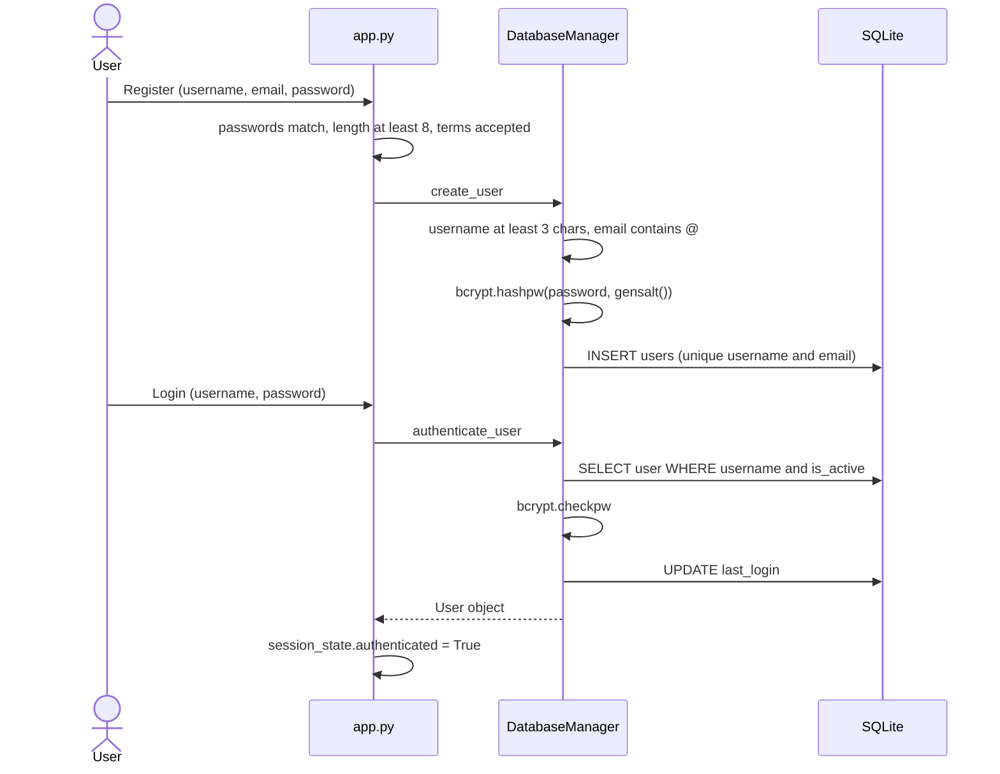
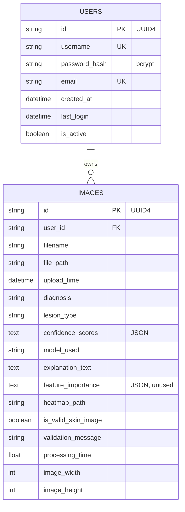

# 10 · Application, storage and security

[← 09 ABCDE heuristics](09-abcde-heuristics.md) · [Docs index](README.md) · Next: [11 Limitations and verification →](11-limitations-and-verification.md)

## Streamlit execution model

Streamlit re-executes `app.py` from top to bottom on every interaction (button click, checkbox, upload). State that must survive a rerun lives in `st.session_state` (`authenticated`, `user`, `page`, confirmation flags); expensive objects are kept across reruns with `@st.cache_resource` (`get_classifier`, `get_validator`).

A consequence visible on disk: `analysis_page` writes the uploaded file to `user_uploads/<user_id>/<new uuid>_<name>` **at every rerun** while a file is selected, so one analysis can leave several identical copies.

## Authentication



**bcrypt** (Provos and Mazières, 1999) is a deliberately slow, salted password hash. `gensalt()` defaults to cost 12, i.e. $2^{12}$ iterations of the expensive key schedule. A stored hash such as

```text
$2b$12$w/APCAloGFYKdem.XRRzceB85ZWZP3m63L5q6.DMwrquekm6Wf5Cy
└┬┘ └┬┘ └────────── salt ────────┘└──────────── hash ─────────┘
 version  cost   22 chars, 128 bit       31 chars, 184 bit
```

contains everything `checkpw` needs: it re-derives the hash from the candidate password with the stored salt and cost and compares. A unique random salt per user defeats precomputed tables; the cost factor makes brute force expensive. bcrypt only uses the first 72 bytes of a password.

## Data model



* SQLAlchemy ORM over SQLite (`melanoma_app.db`, created on import by `DatabaseManager.init_db()`); sessions use `expire_on_commit=False` and objects are expunged before the session closes so Streamlit can use them afterwards.
* Deleting a user deletes their image rows (`cascade="all, delete-orphan"` at ORM level). `delete_image_record` also removes the uploaded file, but not the heatmap `.npy`.
* Timestamps use `datetime.utcnow()` (naive UTC).

## Pages

| Page | What it does |
|---|---|
| New Analysis | Upload, validation, classification, explanation, saving ([chapter 01](01-system-overview.md)) |
| History | Statistics (total, valid, "Malignant findings"), table of the 50 most recent analyses, detail view, rename, delete with confirmation |
| Settings | Account information, CSV export of the history; "Clear Analysis History" is a placeholder that does not delete anything |
| About | Static description |

## Security considerations

Appropriate for a local, single-machine demo; not sufficient for deployment with real patient data:

* no email verification, password reset, rate limiting or account lockout;
* `update_image_filename` and `delete_image_record` filter by image id only; the UI only exposes the current user's ids, but the functions themselves do not check ownership;
* images, the database and heatmaps are stored unencrypted on local disk;
* real clinical use would require data-protection compliance (for example GDPR in the EU), audit logging and access control.

[← 09 ABCDE heuristics](09-abcde-heuristics.md) · [Docs index](README.md) · Next: [11 Limitations and verification →](11-limitations-and-verification.md)
