# Documentation: how the system works

This folder explains the algorithms and technologies behind the project as one linear path that follows an uploaded image from the browser to the database. Each chapter states what the code does, why, and what the result can and cannot be trusted for. Every figure is either drawn from the code's exact parameters or generated by running the project's own functions (see [`assets/generate_figures.py`](assets/generate_figures.py)).

<p align="center"></p>

## Two ways to read it

| Format | Where | Best for |
|---|---|---|
| **Interactive lab** | [`index.html`](index.html), published at **https://cocopops9.github.io/SkinLesionClassification/** once GitHub Pages is enabled (see below) | Moving sliders, uploading your own image to the ABCDE and validation ports, replaying Keras callbacks, building an ensemble |
| **Markdown chapters** | the files listed below, rendered directly by GitHub | Reading on GitHub, linking to a specific topic, offline study |

## The path

| # | Chapter | Question it answers | Main code |
|---|---|---|---|
| 01 | [System overview](01-system-overview.md) | Which component does what, and in which order? | `app.py` |
| 02 | [Labels and data](02-dataset-and-labels.md) | What are the 7 classes and how is imbalance handled? | `classification.py`, `train.py` |
| 03 | [Input validation](03-input-validation.md) | How does the app reject non-skin images? | `image_validator.py` |
| 04 | [Preprocessing and architecture](04-preprocessing-and-architecture.md) | How are pixels turned into a 7-way prediction? | `classification.py` |
| 05 | [Training](05-training.md) | How were the networks fitted? | `train.py`, `train_config.py` |
| 06 | [Inference and ensemble](06-inference-and-ensemble.md) | How are one or several models combined? | `classification.py` |
| 07 | [Grad-CAM](07-grad-cam.md) | Which image regions drove the prediction? | `explainability.py` |
| 08 | [Occlusion sensitivity](08-occlusion-sensitivity.md) | A second, model-agnostic attribution method (implemented, not used by the UI) | `explainability.py` |
| 09 | [ABCDE heuristics](09-abcde-heuristics.md) | What do the A, B, C, D numbers in the report measure? | `explainability.py` |
| 10 | [Application, storage and security](10-application-storage-security.md) | Accounts, history, files and the database | `app.py`, `database.py` |
| 11 | [Limitations and verification](11-limitations-and-verification.md) | What was checked, how, and what to keep in mind | all |

## Enabling the interactive lab on GitHub Pages

The lab is a static page with no build step and no external dependencies.

1. On GitHub open **Settings → Pages**.
2. Under **Build and deployment** choose **Deploy from a branch**, branch **`main`**, folder **`/docs`**, then **Save**.
3. After about a minute the lab is live at `https://cocopops9.github.io/SkinLesionClassification/`.

`docs/.nojekyll` disables Jekyll so the files are served exactly as committed. To use the lab locally, open `docs/index.html` in a browser or run `python -m http.server -d docs` and visit `http://localhost:8000`.

## Regenerating the figures

The hand-drawn schematic SVGs (`hero`, `pipeline`, `validation`, `architecture`, `augmentation`) are edited directly. The numeric ones are produced by running the project's code:

```bash
pip install -r requirements.txt
python docs/assets/generate_figures.py   # writes training, ensemble, gradcam, occlusion, abcde .svg
```

The JavaScript port used by the lab can be re-validated against the Python implementation with the scripts in [`lab/verify/`](lab/verify/).
